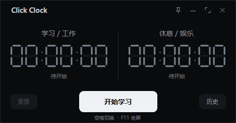

# Click Clock

[](https://github.com/JHChampagne/click-clock/actions/workflows/build.yml)

源自棋钟的 Windows 双侧正计时器。工作与休息之间，一键换边。



## 下载

在 [Releases](https://github.com/JHChampagne/click-clock/releases/latest) 下载最新版：

- [Click-Clock.exe](https://github.com/JHChampagne/click-clock/releases/latest/download/Click-Clock.exe)：单文件，双击即用。
- 便携 ZIP：包含 EXE、中文使用说明与 MIT 许可证。
- `SHA256SUMS.txt`：用于核对下载文件的完整性。

GitHub 的单文件下载名为 `Click-Clock.exe`；便携包内的程序名为 `Click Clock.exe`。

支持 Windows 10 1903 及以上和 Windows 11，使用系统自带的 .NET Framework。无需安装 Python、Node、额外字体或应用运行库，完全离线使用。

## 功能

- 学习／工作与休息／娱乐分别累计，任何时刻只有一侧运行。
- 大按钮或空格一键切换，支持独立暂停、继续及重置。
- 黑底数码管显示，480 × 250 默认窗口、400 × 220 最小窗口，支持高 DPI。
- 拖动缩放、最小化、置顶和全屏；首次启动优先定位到竖向副屏右上角。
- 每日历史、切换次数、单条删除，以及 CSV 导出。
- 自动保存与备份；关闭重开后恢复数据并保持暂停。
- 锁屏继续，系统睡眠自动暂停；唤醒后手动继续。

点击“开始学习”启动计时，之后点击中央按钮切换两侧。暂停状态下切换仍保持暂停。F11 切换全屏，Esc 退出全屏。

详细操作、历史统计规则及数据迁移见 [中文使用说明](docs/usage.zh-CN.md)。

## 数据兼容

记录保存在 `%LOCALAPPDATA%\DualClock`。此目录名沿用早期版本，以保留已有记录、窗口设置及单实例兼容性。

- 同一天只显示一条历史，重置不会清除当天历史。
- 切换次数显示为“0次、1次、2次……”，旧版没有次数信息的记录显示“0次”。
- 升级前先关闭旧版本，再运行新版 EXE。
- 程序运行不需要网络，不包含账号系统或数据上传功能。

## 从源码构建

构建需要 Windows、Git 和 PowerShell 5.1 或以上，以及系统自带的 .NET Framework C# 编译器；无需安装 Visual Studio 或 .NET SDK。

```powershell
git clone https://github.com/JHChampagne/click-clock.git
cd click-clock
powershell -NoProfile -ExecutionPolicy Bypass -File .\scripts\build.ps1
```

程序输出到 `artifacts/app/Click Clock.exe`，测试程序输出到 `artifacts/tests/ClickClock.Tests.exe`。脚本按自身位置解析路径，可以在其他工作目录调用。

运行核心检查（不需要桌面交互）：

```powershell
powershell -NoProfile -ExecutionPolicy Bypass -File .\scripts\test.ps1
```

运行包含窗口布局、不同 DPI、确认框和原生窗口行为的完整检查：

```powershell
powershell -NoProfile -ExecutionPolicy Bypass -File .\scripts\test.ps1 -IncludeLayout
```

完整检查会创建测试窗口，请在可用的 Windows 桌面会话中运行。所有记录和截图均使用独立测试目录，不访问个人计时记录。

生成发布包和校验文件：

```powershell
powershell -NoProfile -ExecutionPolicy Bypass -File .\scripts\package.ps1
```

发布文件位于 `artifacts/release/v1.1.1/`。GitHub Actions 会在推送、拉取请求和手动触发时构建、运行核心检查并保存发布包。

## 项目结构

```text
src/ClickClock/     应用源码与 Windows 清单
tests/             计时、保存、迁移及界面检查
assets/            应用图标
scripts/           构建、测试和打包脚本
docs/              使用说明与界面图片
.github/workflows/  Windows CI
artifacts/         本地生成物，不提交 Git
```

代码使用 C#、WinForms 和 .NET Framework。内部命名空间 `DualClock` 为历史实现标识。

## 验证范围

应用已在 Windows 11 和 1080 × 1920 竖屏上检查主要操作。自动检查覆盖跨午夜、系统时间调整、保存失败回滚、旧版迁移和多档 DPI；睡眠通过模拟系统挂起事件验证。Windows 10 尚未做实机测试。

## 许可

[MIT](LICENSE) © 2026 JHChampagne。版本变化见 [CHANGELOG](CHANGELOG.md)。
